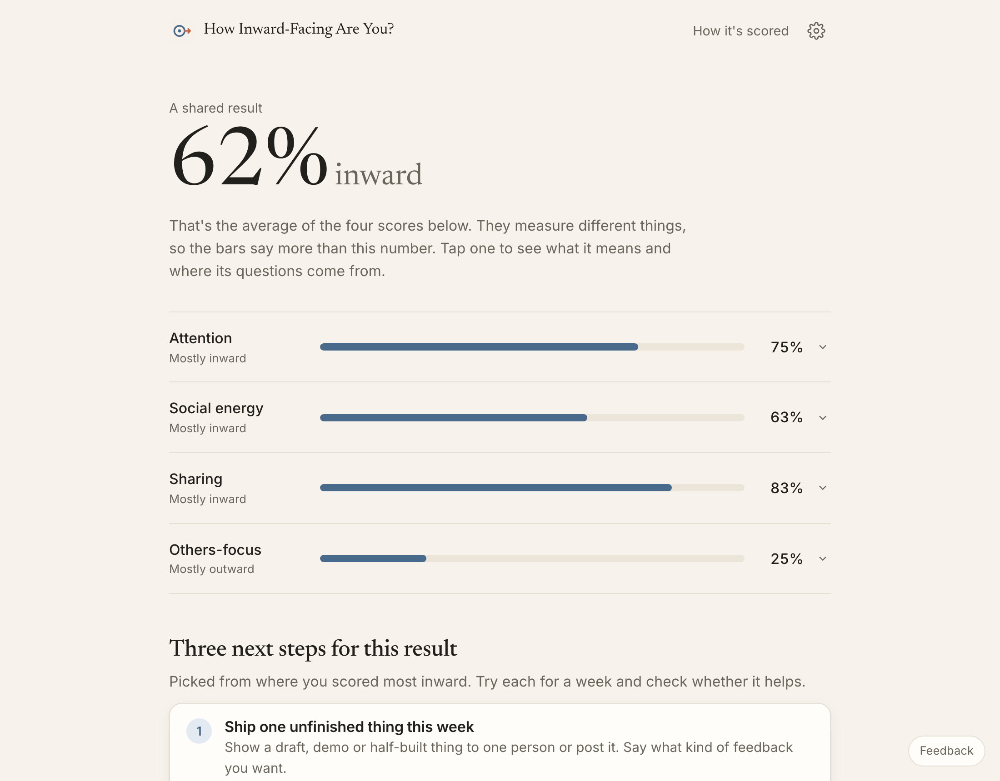
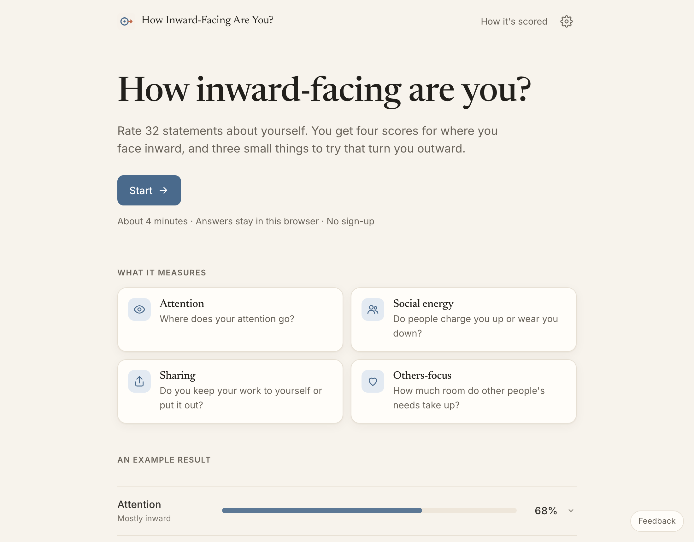
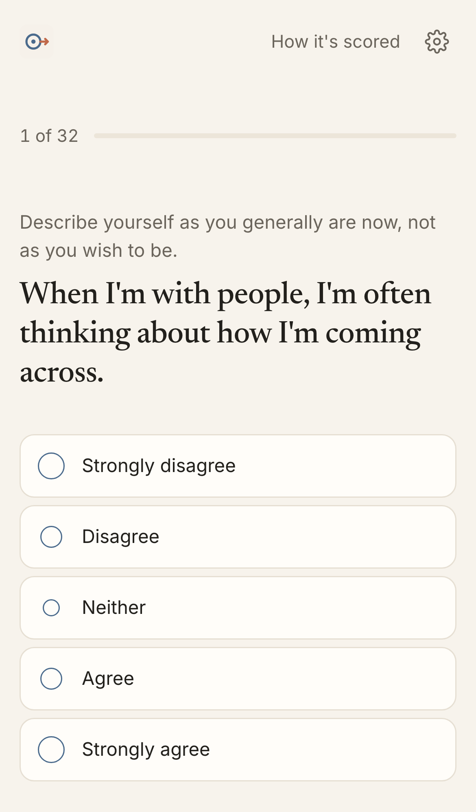
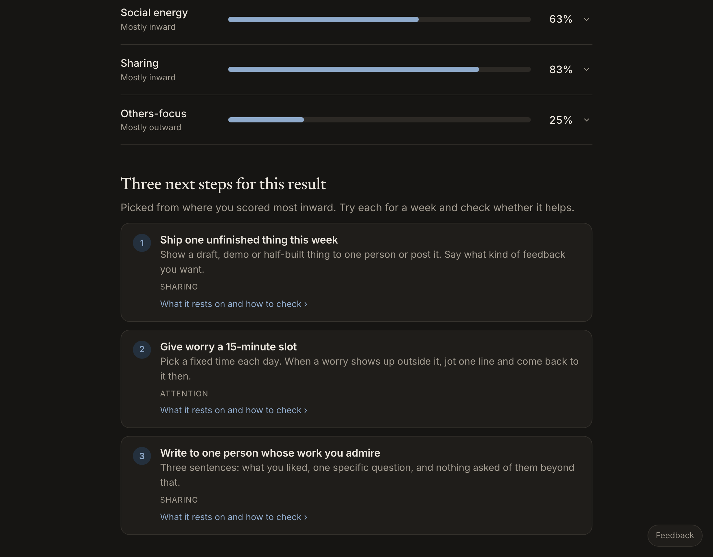
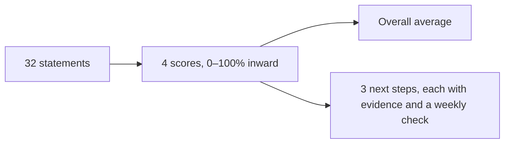

# How Inward-Facing Are You?

A 4-minute quiz that scores how inward-facing you are on four dimensions, then gives you three small, checkable steps to face outward. Answers never leave your browser.

**[Take it →](https://amalmehta.github.io/HowInwardFacingAreYou/)**

| Home | Quiz on a phone | Dark mode |
|---|---|---|
|  |  |  |

Social energy and Others-focus use public-domain, validated IPIP scales. Attention and Sharing use new items, labeled as unvalidated in the app.

- [How to run, test and use it](docs/INSTRUCTIONS.md)
- [System design](docs/SYSTEM-DESIGN.md)
- [What's where](docs/FILE-STRUCTURE.md)
- [Prompt log](docs/PROMPTS.md)
