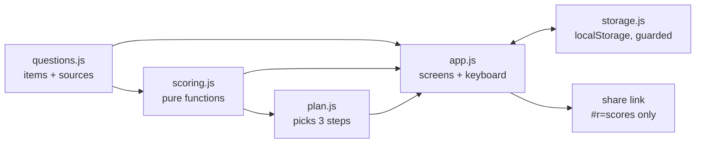

# System Design

How Inward-Facing Are You? is a static website. You answer 32 statements and get four "inward" scores, an overall average, and three next steps. Nothing leaves the browser.

## Architecture

| Component | Job |
|---|---|
| `site/js/questions.js` | The 32 items, the dimension each belongs to, whether agreeing means inward or outward, and each scale's source (validated IPIP or original). Pure data. |
| `site/js/scoring.js` | Turns answers into dimension percentages, the overall average and bands. It has no DOM access, so Node tests it directly. |
| `site/js/plan.js` | The step library (each step has a citation or "practice", plus how to check it) and the rule that picks 3. Pure. |
| `site/js/storage.js` | Reads and writes in-progress answers and settings in try/catch. It works when storage is blocked: progress just isn't remembered. |
| `site/js/app.js` | Screens (Home, Quiz, Results, How it works), keyboard input, settings, share link. |
| `site/index.html`, `site/css/style.css` | One page with light/dark tokens. KaTeX (pinned 0.16.9, cdnjs) is only for the formula on "How it works". |

## Main flows

1. **Take it.** Home → Start → one statement per screen. Click or press 1–5 and it moves on; Back or ← goes back. Each answer is saved straight away, so a reload resumes where you were.
2. **Results.** Overall %, four bars with band and validated/unvalidated tag, then 3 steps. Each step folds open to show "What this rests on" and "How to check it".
3. **Share.** The link `#r=71-55-66-48` holds only the four scores, never answers. Opening it shows the results (the steps are re-derived from the scores).
4. **Settings** (gear, or ⌘/Ctrl + ,): theme, reduce motion, clear saved answers.

## Where data lives

Only in the visitor's browser (`localStorage` key `hifay.v1`). There's no server, no analytics and no cookies. The share link carries four integers.

## Key decisions and trade-offs

- **Four scores, not one.** The four constructs aren't the same thing, so one number would hide where someone is inward. The cost is simplicity. The overall number is kept but labeled as an average of different scales.
- **Validated where possible.** Social energy and Others-focus use public-domain IPIP scales. No free validated scale fit Attention and Sharing, so those use original items, tagged "new, unvalidated" in the UI.
- **No margin of error or percentiles.** Without norm data, any ± or "top 20%" would be made up.
- **Temperament isn't treated as a problem.** Social energy gets a step only when nothing else applies, and that step is marked optional. That follows the kickoff answer "depends on dimension".
- **No framework or build step.** Four small ES modules. GitHub Pages serves `site/` as is.
- **Feedback goes to GitHub Issues**, not email, so no address is exposed on a public page.

## Testing

- `npm test`: Node's built-in test runner on scoring and plan logic (keying, bounds, bands, plan rules, share-link parsing including malformed input).
- `npm run test:ui`: Playwright (Chromium and WebKit at desktop and 375 px phone size). It covers the full quiz by keyboard and by click, resume after reload, the share link, a malformed share link, settings, dark mode, and an axe-free label check of the main controls.

## Scale and what would change

Today's load is one person and a few friends, served as static files from a CDN. That holds for any traffic. The things that would change:
- **Tracking over time or comparing with friends** needs accounts and a database. `storage.js` is the only module that would change.
- **Norms or percentiles** need consented response data (a backend plus an ethics/privacy review). They would then plug into `scoring.js`.
- **Translations** need item text moved into per-language files, with the same keys.

## Known limits

- Attention and Sharing items are unvalidated, with unknown reliability.
- Self-report can be gamed: answering as you'd like to be moves the score.
- Band cut-offs (40/60) are invented for readability, not empirical.
